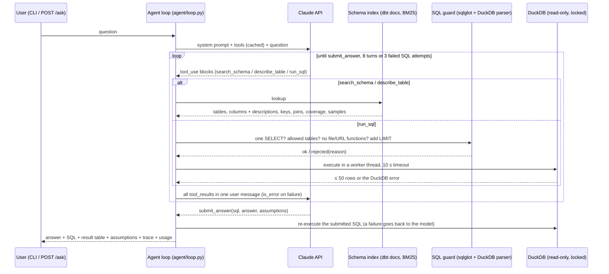

# Text-to-SQL Agent

An agent that answers natural-language questions about a fleet-telemetry warehouse. It
uses the Claude API's tool use over the dbt marts that
[telemetry-data-platform](../telemetry-data-platform) builds in DuckDB. The model:

1. looks up the schema in an index built from dbt's `manifest.json` and `catalog.json`;
2. writes DuckDB SQL and runs it through a guarded, read-only `run_sql` tool;
3. reads any database error, fixes the SQL and retries, with a bounded number of attempts;
4. submits the final SQL, an answer and its assumptions.

An evaluation harness scores **execution accuracy** on a labelled question set by comparing
result sets.

| Resume claim | Where it lives |
|---|---|
| Natural-language questions over the platform's dbt models | `agent/loop.py` queries the platform's `warehouse.duckdb` (`WAREHOUSE_PATH`) |
| Schema retrieval | `agent/schema_index.py`: one document per mart model from `manifest.json` + `catalog.json`, searched with BM25 by the `search_schema` tool |
| SQL generation through tool use | `agent/tools.py`: four strict JSON-Schema tools; SQL reaches DuckDB only through `run_sql` |
| Self-correction on query errors | DuckDB errors go back as `tool_result` with `is_error: true` plus a column hint; at most 3 failed SQL attempts per question |
| Execution accuracy on a labelled question set | `eval/questions.jsonl` (50 questions with gold SQL), `eval/compare.py` (result-set comparison), `make eval` |
| Read-only guardrails against unsafe SQL | `agent/db.py` + `agent/sql_guard.py`: read-only file, external access off and config locked, a sqlglot allow-list, LIMIT and timeout; 54 attacks in `eval/attacks.py` |

> **Status (2026-11-24).** Everything below runs offline and is tested:
> - 142 pytest tests (139 in CI, which skips the 3 that need the platform warehouse), including the attack list;
> - the loop with Claude mocked, both in-process and as the real SDK against a fake HTTP endpoint;
> - a mock-client eval on the seed and on the platform warehouse.
>
> **No Anthropic API key was available while this was built.** So the model has not yet
> answered a question: the results block below is empty, and `docs/sample_runs.md` has not
> been generated. The 50 gold queries were run and checked against the warehouse
> (`eval/gold_results.json`), but they are marked `verified_by: "pending"` until Jay
> reviews them with `make verify-questions`. Next steps are
> [at the end](#what-is-left-to-do).

## Architecture



## Quickstart

```bash
make setup                 # .venv with pinned deps; creates .env from .env.example
# put ANTHROPIC_API_KEY in .env
make test                  # 142 tests, no key needed
make ask Q="Did TX-200 devices crash more after upgrading to 1.1.0?"
make eval                  # full eval -> eval/results/ and the README block below
```

The agent reads `../telemetry-data-platform/data/warehouse.duckdb` and that project's
`dbt/target/` docs (run `make backfill` and `make dbt-docs` there). If the warehouse is
missing, it falls back to the **seed warehouse**, a small database with the same schema
built by `make seed`. Columns, order and DuckDB types come from the committed
`seed/dbt_target/catalog.json`, and a test checks that they match.

| Command | What it does |
|---|---|
| `python -m agent.cli ask "…" --trace` | Answer, final SQL, result table and full tool trace |
| `python -m agent.cli schema "crash rate by firmware"` | What `search_schema` returns |
| `python -m agent.cli sql "SELECT …"` | Run SQL through the same guard as the model |
| `make demo` | Five sample questions end to end, traces saved to `docs/sample_runs.md` |
| `make serve` | FastAPI: `POST /ask {"question": "…"}`, which returns `answer, sql, rows, assumptions, trace, usage, latency_ms` |
| `make eval` / `make eval-quick` | Eval with all configs, or the main config only |
| `make eval-mock` | Offline pipeline check with the gold-replay client (CI) |
| `make gold` / `make verify-questions` | Record the gold results / hand-check the labels |

## How it works

### Schema index (`agent/schema_index.py`)

There is one document per **mart model**: 10 tables (`dim_*`, `fct_*`). Staging models are
opt-in (`EXPOSE_STAGING`); they are views over Parquet files, which the locked connection
could not read anyway. Each document has:

- the dbt description, plus every column's DuckDB type (from `catalog.json`) and its
  description (from `manifest.json`);
- the primary key and grain, taken from dbt's `unique` / `unique_combination_of_columns`
  tests. dbt's own inferred `primary_key` is wrong for `fct_firmware_daily`;
- join paths from the `relationships` tests;
- the row count, the date range covered, and 3 sample rows, read through the same
  locked connection.

`search_schema` ranks documents with BM25, adding one point for each query word that
appears in the table name, plus a small synonym map (connectivity→lte, upgrade→firmware,
…). The schema is small: about 110 columns whose names share the users' vocabulary. So
lexical retrieval is enough, and it is deterministic and needs no extra dependencies. It
is not perfect, and the eval reports how good it is (18 probe queries, top-1 / top-3). The
agent asks for 5 tables and reads their descriptions, and the **no-retrieval ablation**
measures what retrieval buys (see below).

### Tools (`agent/tools.py`)

| Tool | Input | Output |
|---|---|---|
| `search_schema` | `query`, `k` (enum 1–8) | Ranked tables: description, key, grain, row count, joins, matching columns |
| `describe_table` | `table` | Full documentation: columns, types, descriptions, joins, date coverage, sample rows |
| `run_sql` | `sql`, `purpose` | `columns`, `rows` (≤ 50), `row_count`, `truncated`; or an error |
| `submit_answer` | `sql`, `answer`, `assumptions[]` | Ends the loop; the SQL is re-executed before it is accepted |

Every tool has `strict: true`, `additionalProperties: false` and all fields required. `k`
is an `enum` because strict mode does not support `maximum`. Tool definitions and the
system prompt are byte-identical for every question.

### Agent loop (`agent/loop.py`): a manual loop on purpose

The loop is written by hand, not with a framework or the SDK's tool runner, so that every
step is visible and unit-tested (`tests/test_loop.py`, `tests/test_sdk_wire.py`).

1. **Check `stop_reason` before reading content.**
   - `refusal` → a clear error, with the category.
   - `max_tokens` → a clear error; a truncated `tool_use` is never run.
   - `end_turn` without `submit_answer` → one nudge, then fail.
   - `pause_turn` → continue.
2. **Append the full `resp.content`** to the history every turn. After a server-side
   fallback, drop the thinking and `tool_use` blocks that come before the `fallback` block,
   as the API requires.
3. **Answer all `tool_use` blocks together.** Every block, parallel ones included, gets its
   `tool_result` in **one** user message, with `is_error: true` on failure.
   - The error text is DuckDB's message, cut to 1,000 characters.
   - For "column not found", it adds a hint listing the columns of the tables in the query.
   - An unknown table name is reported as an ordinary SQL error with the list of tables,
     not as a guard rejection.
4. **Limit failures.** After 3 failed SQL attempts (errors, rejections or timeouts), stop
   and return the last error with the trace.
5. **Re-run the submitted SQL.** If it fails, the error goes back to the model as the
   `submit_answer` result.
6. **Record per question:** turns, tool calls, every SQL attempt, guard rejections,
   whether a fallback was used, tokens (uncached, cache read, cache write, output), cost,
   latency and the full trace.

Claude API specifics, checked against the `claude-api` skill and verified on the wire by
`tests/test_sdk_wire.py`:

- **Model:** `CLAUDE_MODEL`, default `claude-opus-5-5`.
- **Effort:** `output_config={"effort": AGENT_EFFORT}`, default `medium`. The variable is
  not called `CLAUDE_EFFORT` because Claude Code sets that one in its own environment.
- **No sampling parameters**, no `thinking` config (adaptive thinking is always on with
  Opus 5.5), no prefill, and no forced `tool_choice`, which returns 400 on current models.
  Instead the system prompt says to finish with `submit_answer`, and the nudge catches a
  model that doesn't.
- **Refusal fallback:** for Opus 5.5 the request goes through
  `client.beta.messages.create(..., betas=["server-side-fallback-2026-07-01"], fallbacks="default")`.
  Turn it off with `CLAUDE_FALLBACK=false`.
- **Prompt caching** uses two breakpoints:
  - one on the system block, which caches tools and system together (above the
    512-token minimum);
  - a top-level automatic breakpoint, so each turn reads the previous turns from cache.

  The eval reports `cache_read_input_tokens`.

### Guardrails: defence in depth (`agent/db.py`, `agent/sql_guard.py`)

| Layer | Mechanism | Stops |
|---|---|---|
| 1 | `duckdb.connect(path, read_only=True)` | CREATE / INSERT / UPDATE / DROP on the warehouse |
| 2 | `enable_external_access=false`, autoload/autoinstall off at connect time, then `SET lock_configuration=true` | `read_csv('/etc/passwd')`, `glob`, `COPY … TO`, `ATTACH` a file, `EXPORT`, `INSTALL`/`LOAD`, and SQL turning any of those back on |
| 3a | DuckDB's own parser (`extract_statements`) | Anything other than exactly one SELECT, including `SELECT 1; DROP …` hidden behind comments, case or whitespace tricks |
| 3b | sqlglot AST allow-list (dialect `duckdb`) | DML/DDL anywhere in the tree (a `DELETE` inside a CTE), `PRAGMA`, `SET`, `ATTACH`, `CALL`, … |
| | | File, URL and SQL-string functions (`read_*`, `glob`, `query()`, `query_table()`, `getenv`), and table functions other than `range` / `generate_series` / `unnest` |
| | | Quoted file paths or URLs used as table names, and any table outside the 10 mart models (snapshots, staging, `information_schema`, `duckdb_settings()`) |
| 4 | Limits | `LIMIT 1000` appended to the outer query when missing; at most 50 rows go to the model; a 10 s timeout through `interrupt()` in a worker thread; 1 GB memory, 2 threads |

Every rejection sends its reason back to the model and is counted in the eval.

**Why isn't `read_only=True` enough?**
`tests/test_sql_guard.py::test_read_only_alone_is_not_enough` shows that a plain read-only
connection still allows all of these. None of them is a "write":
- `read_csv()` on any file;
- `query('…')` on arbitrary SQL strings;
- `CREATE TEMP TABLE`, `PRAGMA` and `SET search_path`.

The attack list (`eval/attacks.py`) runs in CI:
- 54 attacks must be refused;
- 17 legitimate queries must pass;
- 14 lockdown cases run on the connection with the guard bypassed, to prove layers 1–2
  hold by themselves.

## Evaluation (`eval/`)

**Labelled set.** `eval/questions.jsonl` has 50 questions, written as data in
`eval/questions_src.py`:
- 15 easy: single-table filters and aggregates;
- 15 medium: joins, group-bys and date windows;
- 14 hard: SCD2 as-of joins, window functions, before/after-firmware comparisons and
  percentiles;
- 6 unanswerable: driver names, fuel, harsh braking, revenue, weather, video uploads.

Each answerable item has gold SQL that ran on the platform warehouse. Its row count,
first rows and hash are in `eval/gold_results.json`, and every gold answer is non-empty.
The questions were drafted with Claude's help. `verified_by` is `"pending"` until Jay
checks each item with `make verify-questions`, and the report shows how many are verified.

**Execution accuracy** (`eval/compare.py`) runs the gold and predicted SQL on the same
read-only DB, through the same guard, and compares the result sets:
- column names are ignored; columns are matched by position, or the gold columns are
  found among extra predicted columns in any order;
- row order is ignored unless `order_matters`;
- floats and DECIMALs match within a relative tolerance of 1e-6, and NULL equals NULL;
- duplicate rows count (multiset comparison).

An unanswerable item is correct only if the SQL is empty **and** the answer says it can't
be answered.

**Configs** in `make eval`:
- `main` (effort medium);
- `effort_low` and `effort_high`, for the effort sweep;
- `no_retrieval`: every schema document is pasted into the system prompt, and
  `search_schema` / `describe_table` are removed.

Add `--models claude-opus-5-5,claude-sonnet-5-5` for a per-model table.

**Outputs:**
- `eval/results/latest.json` and `latest.md`;
- `eval/results/failures.md`: every wrong answer with its gold SQL, predicted SQL and a
  cause, either automatic or hand-written in `eval/failure_notes.json`;
- archived traces in `eval/results/runs/`.

### Results

<!-- results:start -->
_Not run yet: `make eval` needs `ANTHROPIC_API_KEY`. This block is overwritten from
`eval/results/latest.json` by `make eval`; no number here is typed by hand._
<!-- results:end -->

The pipeline itself is checked without a model. `make eval-mock` replays the gold SQL
through the real loop, guard and scorer; one question in four first sends a broken query
to exercise self-correction. It must score 100% with 0 guard rejections, and CI fails
otherwise. Those runs go to `eval/results/mock_*.json` and never to this README.

## Design decisions

- **Mart models only.** Answers come from the governed layer, with metric definitions
  taken from dbt descriptions. For example, `lte_loss_pct` is defined once, in dbt, not
  re-derived in every answer. The prompt also tells the model to rebuild rates from their
  parts (`100 * sum(crash_count) / sum(device_days)`) instead of averaging daily rates.
- **Two parsers.** DuckDB's parser is the authority on statement count and type, because
  it is the engine that will run the SQL. sqlglot does the tree walk, to find nested
  writes, functions and table references. A query that sqlglot can't parse is rejected,
  with a reason; failing closed is the safe choice.
- **Typos are not attacks.** A misspelled table returns a normal SQL error the model can
  fix. Only real policy violations count as guard rejections, so that number should be 0
  on the labelled set.
- **`LIMIT` is appended as text, not regenerated by sqlglot.** The model's SQL runs
  exactly as written; regenerating it could subtly change dialect-specific functions.
- **The submitted SQL is re-executed.** An answer only counts if its SQL runs; this is
  what "valid SQL after self-correction" measures.
- **A seed warehouse with the platform's schema.** CI and new contributors don't need
  Kafka and Spark. The two aggregate marts are derived with the same SQL as the
  platform's dbt models.

## Limitations

- Lexical retrieval: synonyms are hand-made, and an unusual phrasing can rank the wrong
  table first. With hundreds of tables you would add embeddings or column-level
  retrieval; the ablation shows what retrieval is worth at this size.
- Execution accuracy can give false positives: a wrong query can return the right rows by
  coincidence, most easily for single-number answers. It can also give false negatives,
  for example when a different but defensible rounding is used. The failure analysis is
  where these get caught.
- The abstention check is a keyword match on the answer, together with empty SQL.
- PIVOT, DESCRIBE and SUMMARIZE are rejected, even though they are read-only: the
  allow-list is SELECT-only.
- Timeouts use `interrupt()`. A query stuck inside a non-interruptible operator could
  hold a worker thread until it finishes.
- Data covers 2026-01-01..07, plus a few minutes of live-demo data on 2026-11-23. The
  prompt tells the model to resolve "last week" against the data and to state its
  assumption.

## What is left to do

1. Put `ANTHROPIC_API_KEY` in `.env`. Then run `make demo`, which completes M4's "5
   sample questions + one real run", and `make eval`, which fills in the results block,
   `latest.json` and `failures.md`.
2. Run `make verify-questions` to review the 50 gold queries by hand. Then rerun
   `make eval`, so the report says "50 verified by Jay".
3. Annotate `eval/failure_notes.json` after reading the traces.
4. Push to GitHub so CI runs: lint, 139 tests and the mock eval on the seed.

See `docs/INTERVIEW_NOTES.md` for the questions in the plan's interview section.
